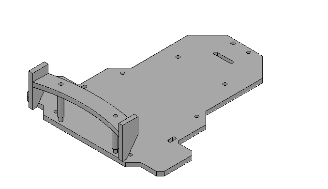
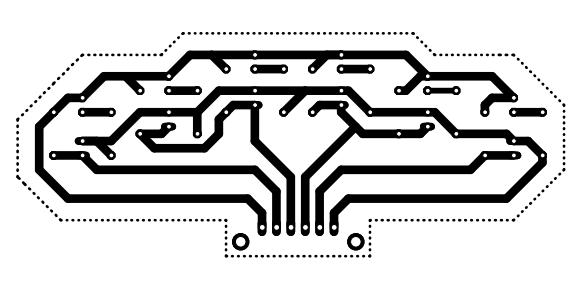
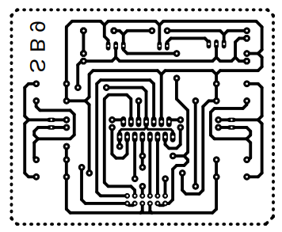

# Line-Following Robot

An Arduino Nano–based mobile robot designed to follow a track using an infrared sensor PCB and a dedicated motor-driver PCB.

> **Project type:** Team project — this repository highlights my personal engineering contribution.

## Project Overview

The robot reads the track through an infrared sensor array and processes the sensor data using an Arduino Nano. The controller then drives the motors through a custom motor-driver board to keep the robot aligned with the track.

## My Contribution

- Designed the infrared sensor PCB layout
- Designed the motor-driver PCB layout
- Fabricated both PCBs
- Designed the robot body parts and chassis
- Programmed the robot using Arduino IDE and C++
- Supported hardware integration and functional testing

## Technology

- Arduino Nano
- Arduino IDE / C++
- Infrared sensors
- Custom sensor PCB
- Custom motor-driver PCB
- DC motors
- CAD-based chassis design

## Result

The robot successfully followed the track during functional testing.

## Engineering Documentation

### Infrared Sensor PCB

Custom PCB layout for detecting the track beneath the robot.

### Motor-Driver PCB

Custom board used to control the robot’s motors from the Arduino Nano.

### Robot Chassis

CAD model used as the mechanical reference for the robot body and component placement.

## Project Status

Functional prototype completed and tested.

> A final assembled-robot photograph is currently unavailable. The PCB layouts and chassis CAD are included as the primary engineering evidence.
